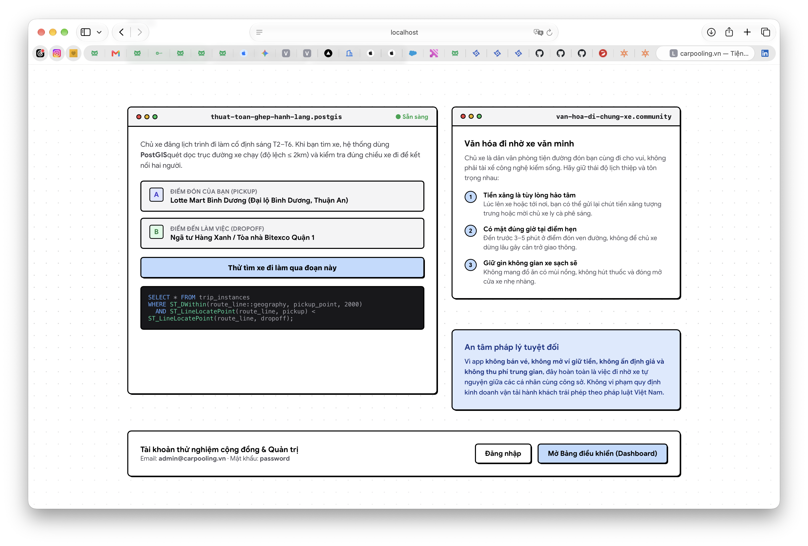
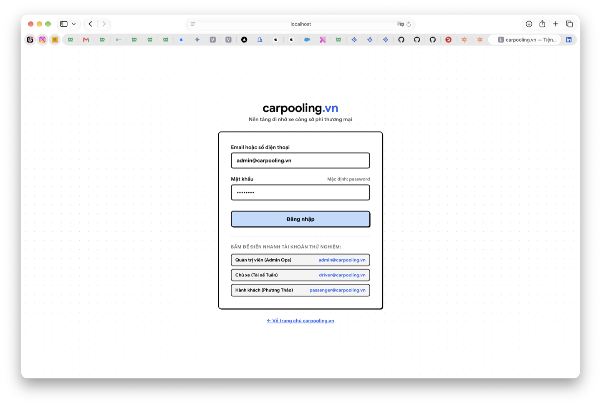
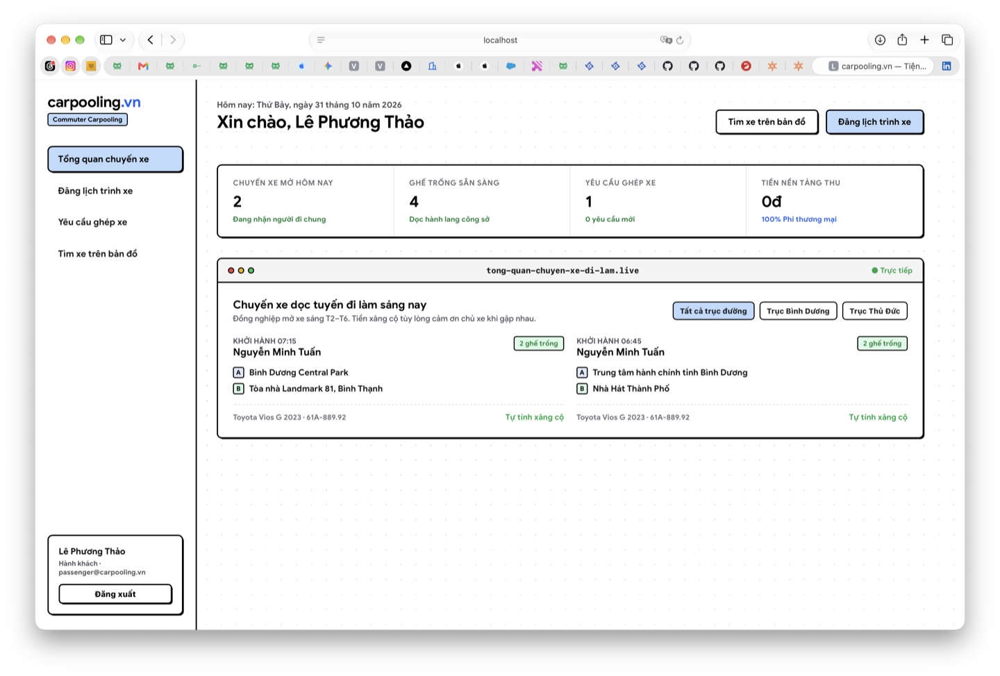
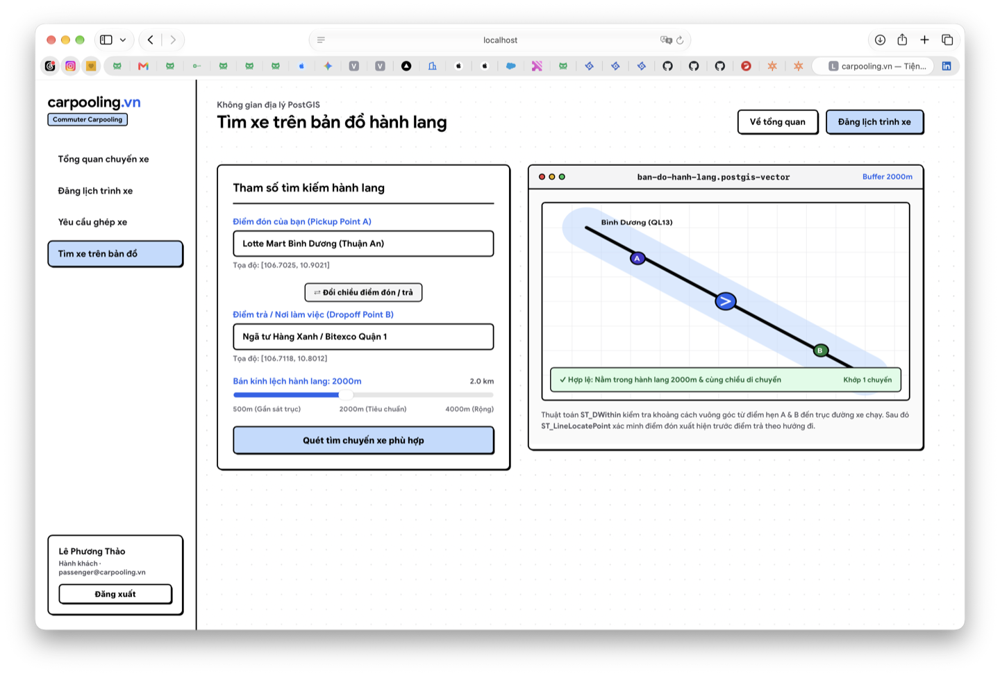
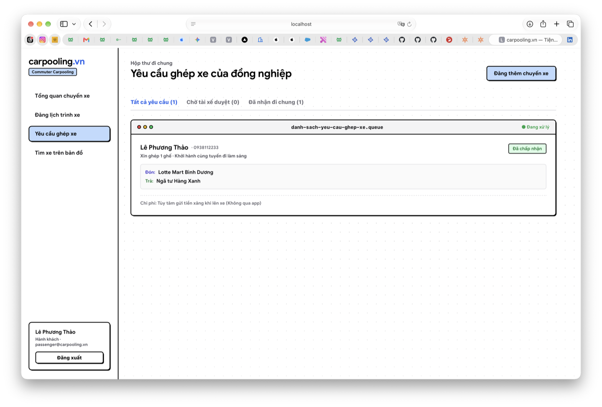

# carpooling.vn — Monorepo

> **Đề tài Đồ án môn học / Khóa luận tốt nghiệp:**  
> **Xây dựng Nền tảng kết nối đi nhờ xe công sở (Commuter Carpooling) 100% phi thương mại tại Việt Nam.**  
> *"Tiện đường thì đi chung, tiền xăng tùy lòng."*

## Giao diện

<p align="center">
  
</p>

<p align="center">
  
</p>

<p align="center">
  
</p>

<p align="center">
  
</p>

<p align="center">
  
</p>

---

## Techstack

[](https://www.php.net/)
[](https://laravel.com)
[](https://react.dev/)
[](https://www.typescriptlang.org/)

---

## 1. Giới thiệu Đề tài & Tinh thần Cốt lõi

`carpooling.vn` là hệ thống công nghệ kết nối những người đi làm có cùng tuyến đường di chuyển hàng ngày (sáng đi làm, chiều về nhà). Dự án giải quyết bài toán lãng phí ghế trống trên ô tô cá nhân vào giờ cao điểm, giảm ùn tắc giao thông đô thị và giảm lượng phát thải carbon.

### Các trụ cột kiến trúc & Pháp lý:
- **Mô hình Monorepo chuẩn công nghiệp**: Tách biệt rõ ràng giữa **Backend (Laravel 13 REST API)** và **Frontend (ReactJS + Vite)** trong cùng một repository được điều phối tập trung.
- **100% Phi thương mại**: Nền tảng **không thu phí trung gian, không ấn định giá vé, không mở ví giữ tiền**.
- **An tâm pháp lý**: Hoàn toàn là hành vi đi nhờ xe tự nguyện giữa các cá nhân công sở, không phát sinh yếu tố kinh doanh vận tải hành khách trái phép theo pháp luật Việt Nam.
- **Tiền xăng tùy lòng**: Người đi nhờ tự nguyện chia sẻ một phần chi phí nhiên liệu, phí cầu đường trực tiếp với chủ xe lúc gặp mặt.

---

## 2. Cấu trúc Thư mục Monorepo (Workspace Architecture)

```text
carpooling/
├── apps/
│   ├── api/                          # BACKEND: Laravel 13 (PHP 8.5)
│   │   ├── app/
│   │   │   ├── Filament/Resources/   # Bảng điều khiển quản trị vận hành (Filament v5)
│   │   │   ├── Http/Controllers/Api/ # REST API (Search, Trips, Bookings, Stats, Auth)
│   │   │   └── Models/               # Eloquent Models (TripInstance, Booking, Vehicle...)
│   │   ├── database/                 # Migrations không gian PostGIS, Seeders mẫu
│   │   ├── routes/
│   │   │   ├── api.php               # REST API endpoints v1
│   │   │   └── web.php               # Web routes & Filament hooks
│   │   ├── composer.json             # PHP Dependencies (Sanctum, Horizon, Filament...)
│   │   └── artisan
│   │
│   └── web/                          # FRONTEND: ReactJS (Vite + TypeScript)
│       ├── src/
│       │   ├── pages/                # HomePage, LoginPage, DashboardPage
│       │   ├── lib/                  # REST API Client, Types, Auth session
│       │   ├── index.css             # Roomio Neo-Brutalist Design System (CSS Tokens)
│       │   ├── App.tsx               # Client-side Routing (React Router)
│       │   └── main.tsx
│       ├── package.json              # React Dependencies
│       ├── vite.config.ts            # Proxy /api -> Laravel Backend
│       └── index.html
│
├── docs/                             # Báo cáo, tài liệu nghiên cứu đề tài
│   ├── screenshots/                  # Ảnh giao diện dùng trong README
│   └── tong-hop-carpooling-viet-nam.docx
├── package.json                      # Monorepo Workspace Orchestration (npm workspaces)
├── docker-compose.yml                # Dịch vụ hạ tầng (PostgreSQL 16 PostGIS, Redis)
├── README.md
└── .gitignore
```

---

## 3. Công nghệ sử dụng (Technology Stack)

| Thành phần | Công nghệ | Chi tiết kỹ thuật |
| :--- | :--- | :--- |
| **Backend API** | **Laravel 13.x (PHP 8.5+)** | REST API chuẩn, Eloquent ORM, Laravel Sanctum Token Auth |
| **Frontend Web** | **React 19 + Vite + TypeScript** | React Router v7, Client-side SPA, proxy API tự động |
| **Spatial Database** | **PostgreSQL 16 + PostGIS** | Thuật toán quét hành lang `ST_DWithin` & kiểm tra chiều `ST_LineLocatePoint` (hỗ trợ SQLite cho Local Dev) |
| **Admin Operations** | **Filament v5** | Quản trị hồ sơ tài xế, phương tiện, chuyến xe và xử lý tố cáo |
| **Background Queues** | **Laravel Horizon + Redis** | Giám sát hàng đợi thông báo và khớp nối chuyến đi |
| **Design System** | **Roomio Neo-Brutalist** | Viền đen sắc nét, bóng đổ cứng `2px 2px 0px -1px #000`, nút bấm không icon có hiệu ứng hover radial wipe |

---

## 4. Thuật toán Ghép Tuyến Hành lang (Corridor Search)

Khác với taxi công nghệ tìm theo bán kính tròn, hệ thống sử dụng thuật toán quét **dọc trục đường xe chạy**:

```sql
-- 1. Tìm các chuyến xe có lộ trình đi qua điểm đón & trả trong phạm vi 2km
SELECT * FROM trip_instances
WHERE ST_DWithin(route_line::geography, ST_SetSRID(ST_Point(pickup_lng, pickup_lat), 4326)::geography, 2000)
  AND ST_DWithin(route_line::geography, ST_SetSRID(ST_Point(dropoff_lng, dropoff_lat), 4326)::geography, 2000)
  -- 2. Đảm bảo điểm đón diễn ra TRƯỚC điểm trả trên cùng chiều di chuyển
  AND ST_LineLocatePoint(route_line, ST_SetSRID(ST_Point(pickup_lng, pickup_lat), 4326)) 
    < ST_LineLocatePoint(route_line, ST_SetSRID(ST_Point(dropoff_lng, dropoff_lat), 4326));
```

---

## 5. Hướng dẫn Khởi chạy (Local Development)

### Yêu cầu môi trường:
- **Node.js** >= 20.x & **npm**
- **PHP** >= 8.5 & **Composer**

### 1. Cài đặt toàn bộ Monorepo:

Tại thư mục gốc dự án:
```bash
# Cài đặt node dependencies cho toàn bộ workspace
npm install

# Cài đặt PHP dependencies cho backend
cd apps/api && composer install && cd ../..
```

### 2. Thiết lập CSDL Backend:

```bash
cd apps/api
cp .env.example .env
php artisan key:generate
php artisan migrate --seed
cd ../..
```

### 3. Khởi chạy toàn bộ dự án (1 lệnh duy nhất):

Tại thư mục gốc dự án:
```bash
npm run dev
```
> Lệnh này sẽ tự động khởi động đồng thời:
> - **Backend Laravel API** tại: [http://127.0.0.1:8000](http://127.0.0.1:8000)
> - **Frontend React Web** tại: [http://localhost:5173](http://localhost:5173)

---

## 6. Danh sách Tài khoản Thử nghiệm & Đường dẫn

### 🌐 Frontend (React App - `http://localhost:5173`):
- **Trang chủ & Mô phỏng ghép hành lang**: `/`
- **Đăng nhập**: `/login`
- **Bảng điều khiển (Dashboard & Form Roomio)**: `/dashboard`

### ⚙️ Backend (Laravel - `http://127.0.0.1:8000`):
- **Filament Admin Ops**: `/admin`
- **Laravel Horizon Dashboard**: `/horizon`

### 👤 Tài khoản mẫu:
| Vai trò | Email | Mật khẩu |
| :--- | :--- | :--- |
| **Quản trị viên (Admin)** | `admin@carpooling.vn` | `password` |
| **Chủ xe (Driver)** | `driver@carpooling.vn` | `password` |
| **Hành khách (Passenger)** | `passenger@carpooling.vn` | `password` |

---

## 7. Giấy phép (License)

Dự án phục vụ mục đích học tập, nghiên cứu khoa học và phát triển cộng đồng dưới giấy phép [MIT License](LICENSE).
